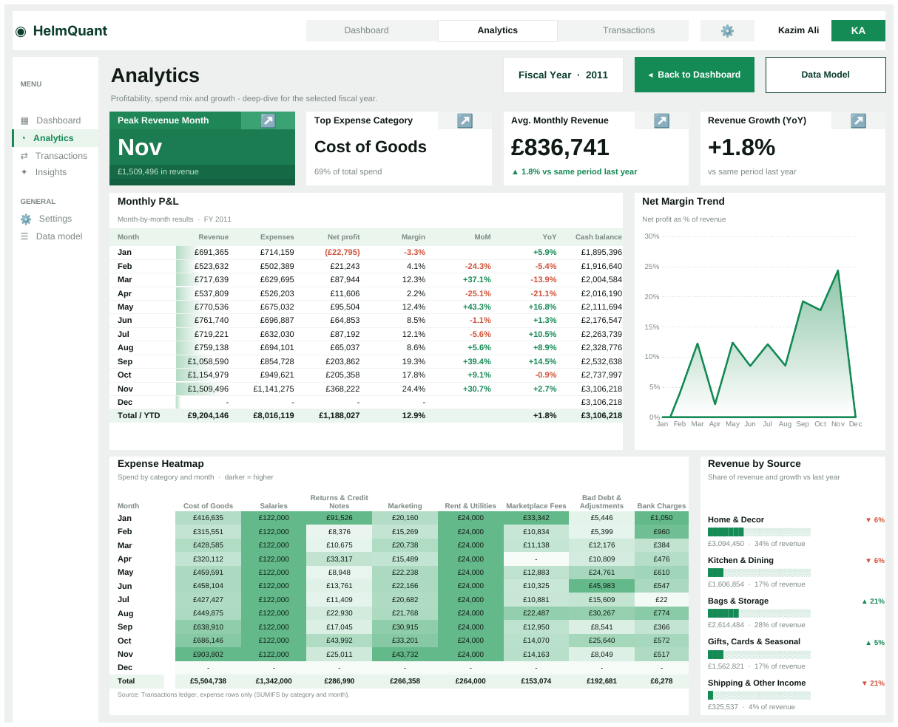
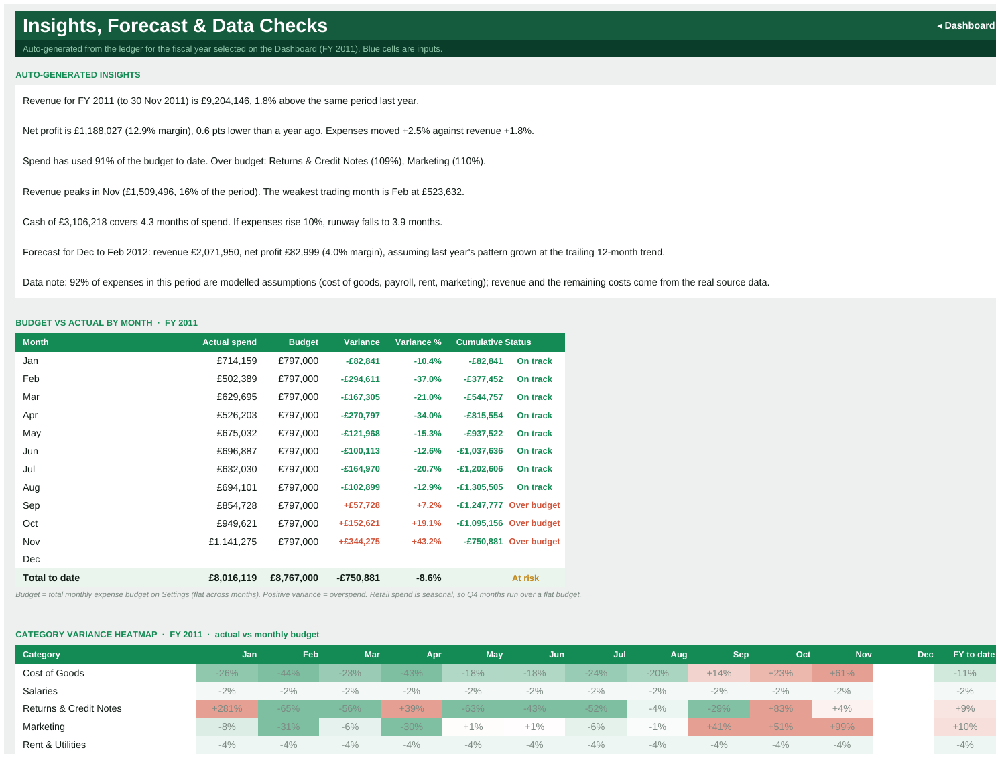

# HelmQuant: Interactive Financial Analytics Dashboard in Excel


---

# 📖 Project Overview

HelmQuant is a formula-driven **financial analytics dashboard built entirely in Excel**, designed to look like a modern SaaS product rather than a spreadsheet. It turns a transaction ledger into an interactive report covering revenue, expenses, profitability, budget control, cash position, a next-quarter forecast and automatic data-quality checks. Everything updates when the fiscal year is changed.

There is no VBA and no hard-coded result. Every number and chart is calculated live from the ledger.

**About the data.** The ledger is built from a **real public dataset**: every invoice of a UK online giftware retailer, December 2009 to November 2011 (UCI *Online Retail II*). Revenue, returns, marketplace fees, bank charges and bad-debt adjustments are real. The source contains no cost data, so four lines (cost of goods, payroll, rent, marketing) are **modelled assumptions**, and every ledger row is labelled `Real` or `Modelled`. Profit, margin, cash and runway are therefore only as real as those assumptions. Full details are in [`data/README.md`](data/README.md).

What the workbook includes:

- Fiscal-year selector that re-drives every KPI, chart and table (FY 2010 and FY 2011)
- Revenue vs expenses combo chart with an auto-highlighted peak month
- Budget utilisation gauge, plus On track / At risk / Over budget status per category
- **Budget vs actual variance by month**, and a category-by-month variance heatmap
- **Next-quarter forecast** (seasonal method) that backtests itself when the forecast months already exist
- **Cash runway sensitivity** (what happens if expenses rise 10% or 20%)
- **Auto-generated insights** written by formulas, so the text changes with the year
- **16 data-quality checks** with an overall status shown on the Dashboard
- Clickable navigation between sheets, and three colour themes: Green, Pink and Dark

---

# 📸 Dashboard Preview

> The screenshots are renders of the workbooks. Open the `.xlsx` files in `dashboards/` for the real, interactive version.

### Dashboard (Green theme)


### Analytics sheet



### Insights sheet: auto-generated insights, variance, forecast, runway and data checks



### Alternate themes

| Pink | Dark |
|------|------|
|  |  |

---

# 📂 Dataset

| Feature | Details |
|---------|---------|
| Source | UCI Machine Learning Repository, *Online Retail II* (real invoices of a UK online giftware retailer) |
| Ledger rows | 4,108 (4,012 real, 96 modelled), rolled up from about 1.02 million invoice lines |
| Period | 1 Dec 2009 to 30 Nov 2011 (whole months only), in GBP |
| Income categories | Home & Decor, Kitchen & Dining, Bags & Storage, Gifts Cards & Seasonal, Shipping & Other Income |
| Real expense categories | Returns & Credit Notes, Marketplace Fees, Bad Debt & Adjustments, Bank Charges |
| Modelled expense categories | Cost of Goods (62% of product sales), Salaries, Rent & Utilities, Marketing (3% of product sales) |
| Fields | Date, Description, Category, Type, Account, Amount, Status, Source |

The ledger is reproducible: `scripts/build_ledger.py` rebuilds `data/helmquant_ledger.csv` from the original UCI file. Cleaning decisions (an overlapping week of duplicated source rows, test lines, partial-month cut-off) are documented in [`data/README.md`](data/README.md). The ledger reconciles to the source to the penny, and a workbook check re-tests that.

---

# 📌 Key Findings (FY 2011, January to November)

Findings that rest on **real data** come first.

- **The business is highly seasonal.** September to November produce 40% of the period's revenue, and November (£1.51M) is about 2.9 times February (£0.52M).
- **Growth is flat.** Revenue of £9.20M is only 1.8% above the same period of 2010. Bags & Storage grew 21%, while Home & Decor and Kitchen & Dining each fell 6%.
- **Returns are rising.** Credit notes were 3.2% of product sales in 2011 against 2.5% in 2010, which pushes Returns & Credit Notes to 109% of budget.
- **Marketplace fees are a steady drag.** Amazon fees cost £153k, 1.7% of revenue.

Findings that **depend on the modelled costs** (treat as illustrative):

- Net profit is £1.19M, a 12.9% margin, 0.6 points below the same period of 2010, because expenses grew 2.5% against revenue growth of 1.8%.
- Closing cash is £3.1M (including an assumed £450k opening balance), about 4.3 months of runway. A 10% rise in expenses cuts that to 3.9 months.
- Overall spend used 91% of budget. Marketing is the other category over budget, at 110%.
- Net profit reached 79% of the assumed £1.5M goal.
- The forecast for December to February shows revenue of about £2.07M but a net margin of only 4.0%: fixed payroll and rent bite hardest in the January and February trough.

---

# 🗄️ Metric definitions

| Metric | Definition |
|--------|-----------|
| Window | 1 Jan of the selected year up to the earlier of 31 Dec and the last ledger date |
| Net profit | Revenue minus all expenses in the ledger. There is no tax line, so it is a pre-tax figure |
| Net margin | Net profit divided by revenue |
| Same-period comparison | The same window one year earlier. If the ledger does not cover that window, the comparison is shown as unavailable (this is why FY 2010 has no year-on-year figures) |
| Budget to date | Monthly budget (Settings) multiplied by the months elapsed in the window |
| Budget status | **On track** below 90% of budget to date, **At risk** from 90% to 100%, **Over budget** above 100% |
| Cash balance | Opening cash plus all income minus all expenses up to month end |
| Cash runway | Closing cash divided by average monthly expenses over the window |
| Forecast | For each of the next 3 months: same month last year multiplied by trailing-12-month growth (revenue and expenses separately). If the ledger has less than two full years before the window end, no growth is applied and last year's pattern repeats |

I used a seasonal forecast rather than a straight trend line (`FORECAST` / `TREND`) because a retailer that peaks every Q4 would be badly misread by a linear trend.

---

# 🛠 Excel Techniques Used

| Technique | Purpose |
|-----------|---------|
| Excel Table (`tblLedger`) and table-based defined names | The ledger grows automatically when rows are added; every formula follows |
| `SUMIFS` / `COUNTIFS` / `SUMPRODUCT` | Aggregations by date window, category and type, plus the data checks |
| `INDEX` / `MATCH` / `LARGE` / `SMALL` | Ranking of expense categories, latest transactions, weakest month |
| `EOMONTH` / `EDATE` / `DATE` | Month windows, same-period comparison, forecast months |
| Defined names | Readable formulas such as `tx_amt`, `SelYear`, `WinEnd`, `OpeningBal` |
| Data validation | Fiscal-year dropdown, category, type, status, account and source lists |
| Conditional formatting | Status tags, ▲/▼ colouring, data bars, variance colour scale, PASS/FAIL |
| Combo, doughnut and area charts | Revenue vs expenses, expense mix, gauge, balance and margin trends |
| Formula-built text | Insight sentences assembled with `TEXT`, `IF` and `&` |
| `NA()` chart helpers | Stop charts plotting months that have no data yet |
| `HYPERLINK` and cell links | In-workbook navigation and the "Add Transaction" button |
| Cell-based UI design | Card layout, gradients and typography built from formatted cells |

---

# 🧱 Workbook Structure

| Sheet | What it does |
|-------|--------------|
| **Dashboard** | Main view: 4 KPI cards, cash position, revenue vs expenses, balance trend, expense breakdown, budget gauge, top spending, upcoming payments, recent transactions, profit goal, data-check status |
| **Analytics** | Monthly P&L, net margin trend, expense heatmap, revenue by source with growth |
| **Insights** | Auto-generated insights, budget vs actual by month, category variance heatmap, next-quarter forecast, runway sensitivity, 16 data checks |
| **Transactions** | The ledger as an Excel Table, with filters and dropdowns |
| **Settings** | Inputs in blue: name, opening cash, profit goal, monthly budgets, upcoming payments, source control total |
| **Analysis** | The calculation engine that feeds every card and chart |

---

# 💡 Design Decisions

- **Everything is a formula.** Changing the year or adding ledger rows updates the whole workbook with no refresh step.
- **Same-period comparison.** Growth is measured against the same window one year earlier, so partial years are compared fairly.
- **Blue means input.** Hard-coded assumptions live on Settings in blue text; formulas stay black.
- **Real and modelled are never mixed silently.** Every row carries a `Source` label, and an insight line states the share of expenses that is modelled.
- **Checks guard the data.** The reconciliation checks caught a genuine data-prep bug during development (a week of duplicated source rows), which is why they are part of the product.
- **Peak month highlight is dynamic.** A helper column splits revenue into "peak" and "other" series, so the highlighted bar moves with the data or year.
- **Compatible formulas.** The workbook avoids dynamic-array functions (`FILTER`, `SORT`, `XLOOKUP`, `LET`) so it works in Excel 2016 and later, not only Microsoft 365.

---

# 🧪 Testing

- All three workbooks were recalculated end to end: 1,052 formulas, no errors other than two intentional `#N/A` chart-gap cells (`Analysis!N37:O37`).
- Revenue, expenses, net profit, cash, category totals and the latest transactions were cross-checked against an independent pandas calculation; they match to the penny.
- Switching to FY 2010 was tested: prior-year figures are correctly blank, and the forecast backtests against the actual Jan to Mar 2011 results (errors of -5.6%, +5.7% and +16.2% by month).
- Corrupted data was injected deliberately (unknown category, negative amount, out-of-order date, invalid status): exactly the relevant checks turned to FAIL and no formula broke.
- Package integrity was verified (XML validity, relationships, content types), and the ledger inside each workbook matches `data/helmquant_ledger.csv` row for row.

---

# ⚠️ Limitations

- Recalculation and rendering were verified with LibreOffice. Please open each file once in desktop Excel; **Excel for Mac and Excel Online were not tested**, and the screenshots are LibreOffice renders, so fonts and chart details differ slightly from Excel.
- Profit, margin, cash, runway and the forecast depend on the modelled cost assumptions (see above).
- Only whole months from Dec 2009 to Nov 2011 exist, so there are two fiscal years and FY 2010 has no year-on-year comparison.
- Product groups are assigned by keyword and are indicative, not an official taxonomy.
- Single currency (GBP). No tax line.
- The ledger must be sorted oldest first, because Recent Transactions reads the last rows; a data check flags it if not.
- The Dashboard is built from cell formatting, so zoom and screen-resolution differences can shift the layout slightly.

---

# 📂 Repository Structure

```text
financial-analytics-dashboard/
├── dashboards/
│   ├── HelmQuant_Financial_Dashboard_Green.xlsx
│   ├── HelmQuant_Financial_Dashboard_Pink.xlsx
│   └── HelmQuant_Financial_Dashboard_Dark.xlsx
├── data/
│   ├── helmquant_ledger.csv       # the ledger used in the workbooks
│   └── README.md                  # source, cleaning rules, assumptions
├── scripts/
│   └── build_ledger.py            # rebuilds the ledger from the UCI file
├── power_query/
│   └── import_ledger.pq           # template to load a CSV ledger (untested)
├── images/                        # screenshots used in this README
├── LICENSE
└── README.md
```

---

# 🚀 How to Use the Project

1. Clone or download this repository.

```bash
git clone https://github.com/kazimalizaidi/financial-analytics-dashboard.git
cd financial-analytics-dashboard
```

2. Open any file in `dashboards/` with **Microsoft Excel** (desktop version recommended, Windows or Mac).
3. If Excel shows a yellow bar, click **Enable Editing**. The workbook recalculates when it opens.
4. Use the **Fiscal Year** pill at the top of the Dashboard to switch between 2010 and 2011.
5. Click the tabs or sidebar links to move between sheets (the sidebar has a new **Insights** link). Press `Ctrl + Shift + F1` for a clean full-screen view.
6. To use your own data, paste rows at the bottom of the ledger table on **Transactions** (keep dates sorted oldest first, amounts positive, and categories from Settings), then update the budgets on **Settings**. If your data has no control total, set the control total on Settings to 0 to switch that one check off. Check the **Insights** sheet: the data checks tell you if anything is off.

> GitHub cannot display interactive Excel dashboards in the browser, so download the file to explore it.

### Rebuild the dataset

```bash
pip install pandas openpyxl
python scripts/build_ledger.py online_retail_II.xlsx data/helmquant_ledger.csv
```

Download `online_retail_II.xlsx` from the UCI Machine Learning Repository first.

---

# 📌 Future Improvements

- Slicers for category and account (they need a desktop Excel session to set up safely)
- Forecast ranges (best and worst case) instead of a single line
- Multi-currency support and cost-centre breakdowns
- A short screen recording of the year switch and navigation
- Optional Office Scripts for one-click theme switching

---

# 📚 References & Data Sources

- **Data:** Chen, D., *Online Retail II*, UCI Machine Learning Repository. Real transactions of a UK online retailer; see the dataset page for its license and citation terms.
- **Modelled costs and Settings values:** assumptions made for this project, documented in [`data/README.md`](data/README.md).

---

# 🎧 Project Soundtrack

*This track was on loop while working on this project*

[rain - reidenshi, Dagamon](https://open.spotify.com/track/2zFpMThv5f6y4OW79sUR91?si=02f60fccdd834af2)

**Star this repository if you found it interesting!** ⭐

made with ❤️ by **kazim**
