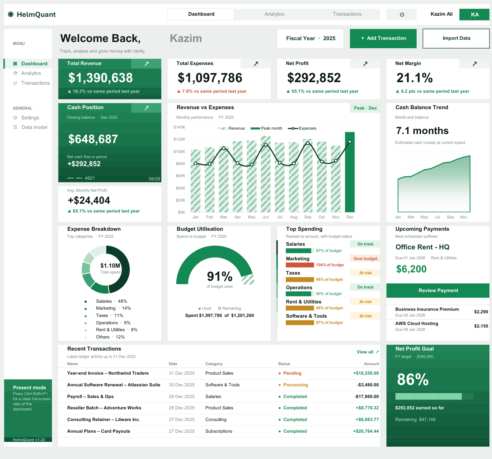
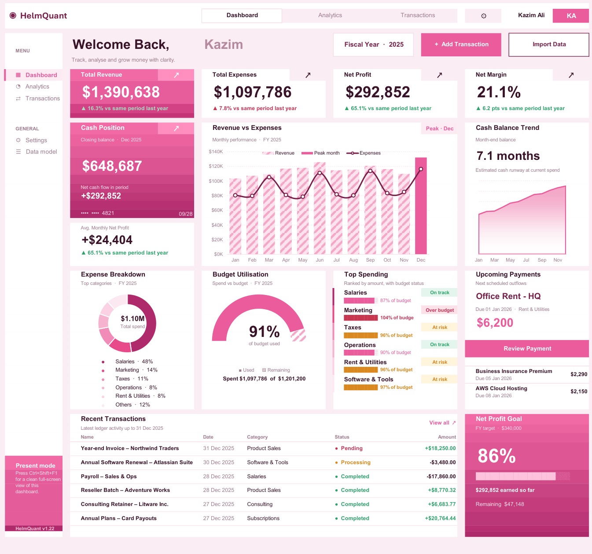
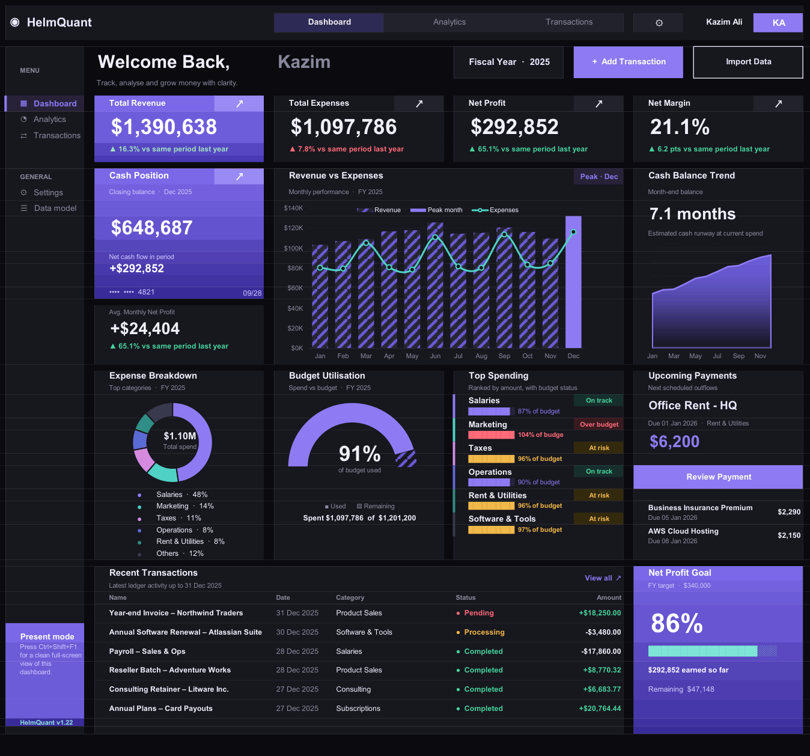

# 💸 HelmQuant: Interactive Financial Analytics Dashboard in Excel


---

# 📖 Project Overview

HelmQuant is a fully formula-driven **financial analytics dashboard built entirely in Excel**, designed to look like a modern SaaS product rather than just a spreadsheet. It turns a raw transaction ledger into an interactive report covering revenue, expenses, profitability, budget control, cash position and growth, all updating instantly when the fiscal year is changed.

There is no VBA and no hard-coded result anywhere. Every number and chart is calculated live from the ledger.

This project includes:

- 📅 Fiscal-year selector that re-drives every KPI, chart and table
- 📈 Revenue vs expenses combo chart with an auto-highlighted peak month
- 🎯 Budget utilisation gauge and On track / At risk / Over budget status per category
- 💰 Cash balance trend and cash runway estimate
- 🔥 Category-by-month expense heatmap
- 🧭 Clickable navigation between sheets, like an app
- 🎨 Three ready-made colour themes: Main, Pink and Dark

---

## 📸 Dashboard Preview

> Screenshots below are previews of the workbook. Open the `.xlsx` files in `dashboards/` for the real, interactive version.

### 🟢 Dashboard (Main theme)



### 📊 Analytics sheet


### 🎨 Alternate themes

| Pink | Dark |
|------|------|
|  |  |

---

## 📂 Dataset

| Feature | Details |
|---------|---------|
| Type | Synthetic business ledger created for this project (not real accounts) |
| Records | 973 transactions |
| Period | January 2023 to December 2025 (three fiscal years) |
| Income categories | Product Sales, Subscriptions, Consulting, Investments, Other Income |
| Expense categories | Salaries, Marketing, Software & Tools, Rent & Utilities, Travel, Operations, Taxes, Insurance |
| Fields | Date, Description, Category, Type, Account, Amount, Status |

The data was generated with seasonality, growth and quarterly tax payments so the dashboard has realistic trends to analyse. Monthly budgets were then set near the 2025 run-rate to show all three budget states.

---

## 🛠 Excel Techniques Used

| Technique | Purpose |
|-----------|---------|
| `SUMIFS` / `COUNTIFS` | All aggregations by date window, category and type |
| `INDEX` / `MATCH` / `LARGE` | Dynamic ranking of expense categories and latest transactions |
| `EOMONTH` / `EDATE` / `DATE` | Month windows and same-period-last-year comparison |
| Defined names | Readable formulas such as `tx_amt`, `SelYear`, `WinEnd`, `OpeningBal` |
| Data validation | Fiscal-year dropdown, category, type, status and account lists |
| Conditional formatting | Status tags, ▲/▼ colouring, data bars and colour-scale heatmap |
| Combo, doughnut and area charts | Revenue vs expenses, expense mix, semi-donut gauge, balance trend |
| `HYPERLINK` and cell links | In-workbook navigation and the "Add Transaction" button |
| Cell-based UI design | Card layout, gradients and typography built from formatted cells |

---

## 🧱 Workbook Structure

| Sheet | What it does |
|-------|--------------|
| **Dashboard** | Main view: 4 KPI cards, cash position, revenue vs expenses, balance trend, expense breakdown, budget gauge, top spending, upcoming payments, recent transactions, net profit goal |
| **Analytics** | Monthly P&L table, net margin trend, expense heatmap, revenue by source with growth |
| **Transactions** | The ledger (rows 6 to 3000) with filters and dropdowns |
| **Settings** | Inputs in blue: name, opening cash, profit goal, monthly budgets, upcoming payments |
| **Analysis** | The calculation engine that feeds every card and chart |

---

## 📌 Key Findings (FY 2025, sample data)

- Revenue reached **$1.39M**, up **16.3%** on the same period last year, while expenses were **$1.10M**.
- Net profit was **$292.9K**, up **65.1%**, lifting net margin from **5.8% (2023)** to **14.8% (2024)** to **21.1% (2025)**.
- Closing cash stood at **$648.7K**, which is about **7.1 months** of runway at the current spend rate.
- **Marketing** is the one category over budget at **104%**, while Salaries make up **48%** of total spend.
- Overall spend used **91%** of the budget, and net profit reached **86%** of the $340K goal.
- Revenue and margin dip in quarterly tax months (March, June, September, December), which is visible in the Monthly P&L.

---

## 💡 Design Decisions

- **Everything is a formula.** Changing the year or adding ledger rows updates the whole workbook with no refresh step.
- **Same-period comparison.** Growth is measured against the same window one year earlier, so partial years are compared fairly.
- **Blue means input.** Hard-coded assumptions live on the Settings sheet in blue text, formulas stay black.
- **Peak month highlight is dynamic.** A helper column splits revenue into "peak" and "other" series, so the highlighted bar moves when the data or year changes.

---

## 📂 Repository Structure

```text
financial-analytics-dashboard/
├── dashboards/
│   ├── HelmQuant_Financial_Dashboard_Green.xlsx
│   ├── HelmQuant_Financial_Dashboard_Pink.xlsx
│   └── HelmQuant_Financial_Dashboard_Dark.xlsx
├── images/                 # Screenshots used in this README
└── README.md
```

---

# 🚀 How to Use the Project

1. Clone or download this repository.

```bash
git clone https://github.com/kazimalizaidi/financial-analytics-dashboard.git
cd financial-analytics-dashboard
```

2. Open any file in `dashboards/` with **Microsoft Excel** (desktop version recommended, Windows or Mac).
3. If Excel shows a yellow bar, click **Enable Editing**.
4. Use the **Fiscal Year** pill at the top of the Dashboard to switch between 2023, 2024 and 2025.
5. Click the tabs or sidebar links to move between sheets. Press `Ctrl + Shift + F1` for a clean full-screen view.
6. To use your own data, paste rows into **Transactions** (keep dates sorted oldest first) and update budgets on **Settings**.

> GitHub cannot display interactive Excel dashboards in the browser, so download the file to explore it.

---

# 📌 Future Improvements

Potential enhancements include:

- Forecasting section with a simple trend projection for the next quarter
- Multi-currency support
- Cost-centre or department breakdowns
- Power Query import for live CSV or bank-export data
- Budget vs actual variance by month
- Optional VBA or Office Scripts for one-click theme switching

---

# 📚 References & Data Sources

- **Data:** Synthetic sample data generated for this project. Company names are fictional.

---

**Star this repository if you found it interesting!** ⭐

made with ❤️ by **kazim**
